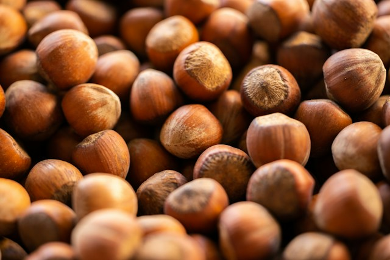

+++
title = "Hazelnut - A short story"
url = "2026/09/hazelnut" 
date = 2026-09-19
description = "A short story about belonging, identity and an awkward coffee in a new country"
tags = ["Indian Diaspora", "Literary Fiction", "Short Story"]
showRelatedContent = false
+++

**The Story So Far**

[Answer Paper](https://prowritersroom.com/answer-paper/)

A narrator describes the first few days of middle school. The students are already dealing with class differences, like “Foreign-resident-dad” vs kids baked in Chennai sun, or kids with sincere siblings vs kids with notorious siblings. A math teacher makes things worse. During an answer paper distribution, the narrator, who has already had an incident with the teacher, starts tearing her answer sheets, and when confronted, blames squirrels.

---

Hema arrived five minutes early at Luna Cafe in Cambridge. The glass door reflected her MIT sweatshirt, faded blue jeans, and a bulky laptop bag. She felt simultaneously overdressed and underdressed. She decided to wait at a canopied sidewalk table.

The weather was unusually warm for a winter day. Her research advisor – and only acquaintance – had warned her about Fool’s Spring. She couldn’t wait for the real one. She might even have a friend by then.

She turned around to a “*HEMS\! It is SOOO good to see you*”, and took in Meena’s appearance \- sleeveless top, gym shorts, and outstretched arms that hugged her with familiarity as her own hands flailed to find the right position. Hema resigned herself to being lonely for longer. 

\*\*\*

“*Have you settled in? Winter here is gorgeous,*” said Meena, as they sat down with their drinks.  
“*I didn’t realize it was possible for a place to be this cold. I prefer getting baked in the Chennai sun.*”  
“*Horrible\! I couldn’t wait to escape that place during summer holidays.*”  
Foreign-resident-dad had the luxury of escape.  
“*It didn’t help that I had no friends in that school. I was seen as an outsider. As if growing up here was my fault.*”   
Hema stared at the dryness in her open palms. She hastily hid them and took a sip of her latte. She could do better \- moisturize, order lattes without hazelnut syrup, and quit judging.

“*How are you doing?*”, she asked.  
“*Splendid\! I love the museums here. A paradise for art history students. My parents live a short drive away in Rhode Island. Can’t complain.*”  
“*That’s nice. They must like having you nearby.*”  
“*They do. I sometimes wish I lived elsewhere though,*” Meena smiled.   
“*Hmm, why?*”  
“*I don’t know.*" They looked at the built-up snow beside the narrow street. Browned by dirt, it was starting to melt, like a puddle of chocolate. It looked disgusting. “*Dad found this guy, and thinks I should marry him. His family owns a business in India.*”  
“*Really? That’s… surprising.*”  
“*Oh they are old-school.*”  
“*So?*”  
“*He looks nice and all. But then, he seems too…can’t explain. Forget it. What about you? Did you say you are in a masters’ program?*”  
“*PhD. Applied Math..*”  
“*Oh my gawd, it’s him\! Is he stalking me or what\!*”

Hema followed her eyes, and saw a Cybertruck stopping beside the street. Looking out from inside the canopy, the light glared as it reflected on the snow. The driver looked familiar. She involuntarily stood halfway for a better view, and her arms moved over her forehead to shield the sunlight. As her palms closed automatically, she stood there like a general spying at foes through a pair of binoculars. And then she remembered.

Rohit Jyoshi. *Gigachad*. She absent-mindedly scratched a dry-skin itch on her neck. 

“*Hey, babe\! So good to see you,*” Rohit joined them and hugged Meena. Her hands rested on his shoulders lightly.  
“*Rohit\! You look tip-top today.*"   
"*Guess where I am going,*” he said, sitting on a chair facing away from the street.  
"*Where?*"   
“*Papa got me an appointment with Dr. Shergil. He is counting on me to make this deal happen.*”  
“*Amazing\!*”  
“*I am also going to ask him if he can advise you. Dr. Shergill studied the use of blue pigmentation in ancient Indian paintings.*”  
“*But why? I already have Prof. Blake.*"   
"*Listen, Prof. Blake is a moron. I am sure he thinks blue pigmentation originated in Germany.*”  
“*Prussian blue did. You are talking about Indigo blue.*"   
“*You are so pedantic. No wonder you haven’t finished your thesis and graduated yet. With the right advisor, you would have been done by now.”*  
*Meena bit her lips, and used her napkin to wipe something away from her eyes.*  
"*Won’t you introduce your friend? We haven’t met.*”  
“*Actually, we have*”, said Hema.  
Rohit waited, but she didn’t elaborate.  
“*I’m sorry, I have poor memory. Where have I had the pleasure of meeting you?*”  
“*I stopped by the Yuva Sanskriti stall during orientation. Aren’t you their President?*”  
“*Ah, right. Lovely. Thank you for stopping by. Things get lonely here, and I believe in being connected to our roots. I hope you signed up to join?*”  
“*Not really. I don’t believe in culture.*”  
Rohit’s mouth opened and closed wordlessly as he glanced at Meena. “*Hmm, interesting. What is your name again?*”  
“*Hema*”  
“*Look, Hema. You just came here, and all this seems attractive*,” he waved his hands around them. “*Trust me, you will soon learn the value of identity.*"   
Hema took another sip of her latte. It still seemed full. Whoever likes hazelnuts? Squirrels maybe.  
"*Not belonging might feel cool, until the loneliness hits you.*”

Meena watched Hema’s hands move to tear off the edges of her paper napkin. She looked up, and saw a hint of an unexpected smile. Rohit was Rohit, intensely patting away a speck of dirt from his chest.

She saw Hema look up at Rohit, who was still focussing on the dirt. 

A swat, a stumble and a shout. Hema’s coffee cup was flat on the table, its contents still dripping on Rohit’s pants. He jumped up, his chair falling into the street, frowning at Hema.

“*Sorry, but I am terrified of squirrels,*” said Hema pointing towards the empty street.  
His eyes caught Meena’s and she shrugged.  

*Photo by [**engin akyurt**](https://unsplash.com/@enginakyurt?utm_source=unsplash&utm_medium=referral&utm_content=creditCopyText) **on [Unsplash](https://unsplash.com/photos/SCpXCeUvgdY?utm_source=unsplash&utm_medium=referral&utm_content=creditCopyText)***

---
This story was originally [published at Pro Writers Room](https://prowritersroom.com/hazelnut/) as part of the Pass The Pen event, continuing from [Answer Paper](https://prowritersroom.com/answer-paper/).

 [The Loneliness of Sonia and Sunny](/2026/07/loneliness-sonia-sunny/) · [Brown](/2026/08/brown/) · [Sigma](/2026/04/sigma/) 
