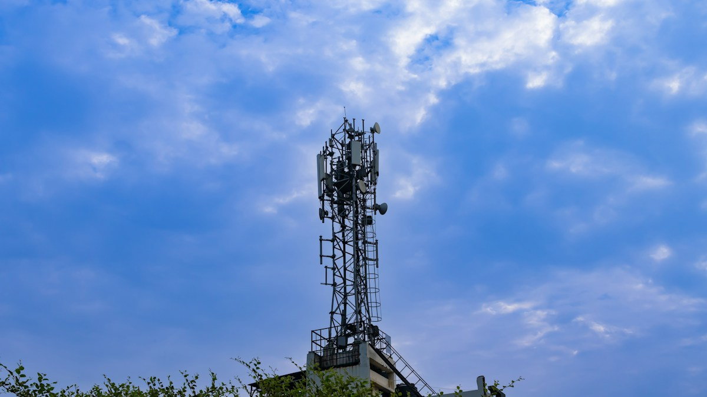

+++
title = "Purple Radiation - A short story"
url = "2026/10/purple-radiation" 
date = 2026-10-11
description = "A short story about two brothers, the tales they tell, and an unlikely superpower"
tags = ["Childhood", "Humor", "Magical Realism", "Short Story"]
showRelatedContent = false
+++

I have a superpower.

It’s not telling stories. I am terrible at that. The last time I did it, people didn’t get it.

That’s Gautam’s superpower. He tells the story of my birth, despite having only been a three-year-old boy excited for his baby brother. Calm sky, no clouds. Silence, and a scramble. A nurse ran into my room sniffing. “*Do you smell something burning?*” The building next to the hospital was on fire. As the fire engines rushed in, moments before I was born, it started to snow.

Years later, my forefingers typed one letter at a time on a computer keyboard: “*has it ever snowed in Chennai?*” Some people claim that it did. In 1815. That didn’t stop me from enjoying Gautam’s rendition of my birth.

There is another story Gautam keeps telling. I partially recall this myself. I was pedalling hard on my Ladybird bicycle one rainy day. Moments earlier, I had seen Gautam’s failed attempt to hide his tears as Raja Anna slapped him. Forgetting that I am a coward, my hands clutched a fistful of slush and flung it at Raja Anna. He wiped his face and screamed as I threw a second ball of filth.

I attempted to flee on my bicycle as he rushed after me. But he was much faster. Quick thinking has never been my ally, but that’s another thing I forgot that day. I headed into a narrow lane that led to a cricket ground. It was now closed for construction.

I remember a rock blocking my path. After that, I recall nothing. Later, Gautam enacted everything for me using a pillow as a prop. I flew into the air with my bicycle, before letting it go. Straight as an arrow, I crashed head-first into the half-built cell-phone tower. Gautam insisted that as I lay on the ground, a purple flash from the tower touched my bleeding forehead and I smiled unconsciously.

In the hospital bed, various uncles and aunties and cousins and friends visited me with Horlicks and sweet lime. Bedridden and bored, I discovered a way to entertain myself after some trial and error. When Thiru uncle dialed his friend’s number to ask for the cricket score, I closed my eyes, and his boss picked up the phone on the other end. When Lalitha aunty called her friend to complain about her useless husband, he himself answered the call. I couldn’t wait to share this with Gautam. He completely believed me.

Twenty days later, we followed Raja Anna into an internet cafe. As he looked up at us, Gautam smiled.  
“*Anna, can you ask your Delhi friend to suggest some English movies?*”  
“*Why da? You are too young for all that.*”  
“*Please, Anna.*”

Raja Anna sighed and picked his phone up. I shut my eyes tight as a weight spread inside my forehead.

“*Dei, what was that movie you mentioned last week? The one with the French kissing scene… Aiyo, Amma! Sorry, ma. I was joking!*”

*Photo by [**VD Photography**](https://unsplash.com/@vdphotography?utm_source=unsplash&utm_medium=referral&utm_content=creditCopyText) **on [Unsplash](https://unsplash.com/photos/a-tower-with-a-cell-phone-on-top-of-it-uTMFFOQl4Fw?utm_source=unsplash&utm_medium=referral&utm_content=creditCopyText)***

---
This story was originally [published at Pro Writers Room](https://prowritersroom.com/purple-radiation/) in response to the [Crossed Lines | Five00-26](https://prowritersroom.com/five00-26/) prompt "The number you reached was wrong. The person who answered wasn't."

 [Hazelnut](/2026/09/hazelnut/) · [Sigma](/2026/04/sigma/) · [Trinkets](/2026/06/trinkets/) 
